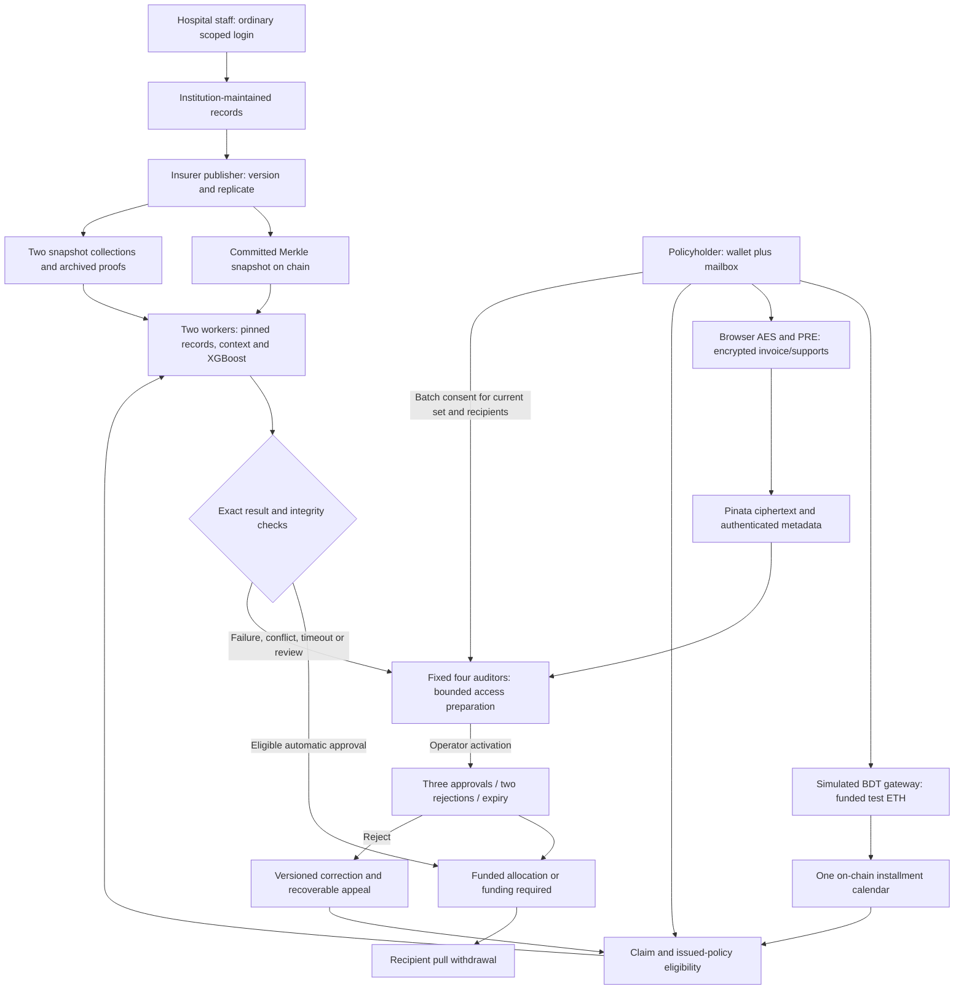

# Current authority and workflow map

The chain enforces policy/payment identity, module authority, decision thresholds
and payout accounting. It cannot prove clinical truth, inspect encrypted files or
prove an auditor read them. Both workers share institutional source/publisher
trust. Their separate execution is not independent medical corroboration.

The service stores authorized PRE transforms, not the patient's private encryption
identity. File/version restrictions also depend on authenticated proxy enforcement.
Owner-offline retrieval begins after consent is stored. Revocation prevents
supported future transforms and cannot erase plaintext already downloaded.

Email verifies mailbox access. BDT ownership, debits and conversion are simulated;
premium credit requires actual funded test ETH. Medical liabilities and the
optional cancellation-refund reserve are distinct. Death/maturity are disabled.
Public metadata, deterministic panel selection, public sequential votes and trusted
administrator governance remain explicit thesis assumptions.
